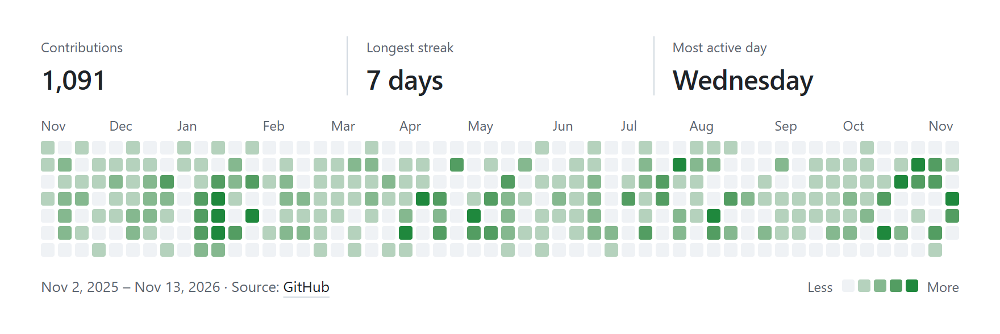

# web-components

Framework-agnostic web components. Each one lives in its own folder and is published as its own package.

| Component | Description |
| --- | --- |
| [`<github-activity>`](./github-activity) | GitHub contribution calendar with stats, themes and i18n, plus a build-time fetcher |
| [`<pull-cord>`](./pull-cord) | Hanging light-switch cord you pull to toggle light and dark themes, with spring physics and a circular reveal |

## License

MIT
