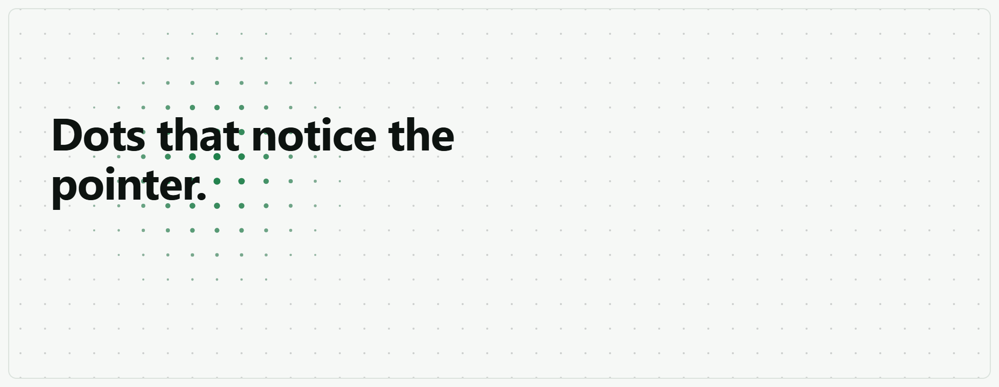
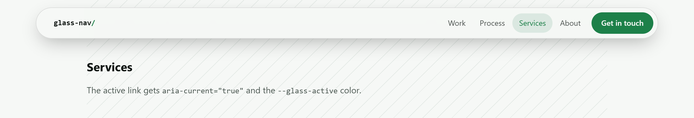
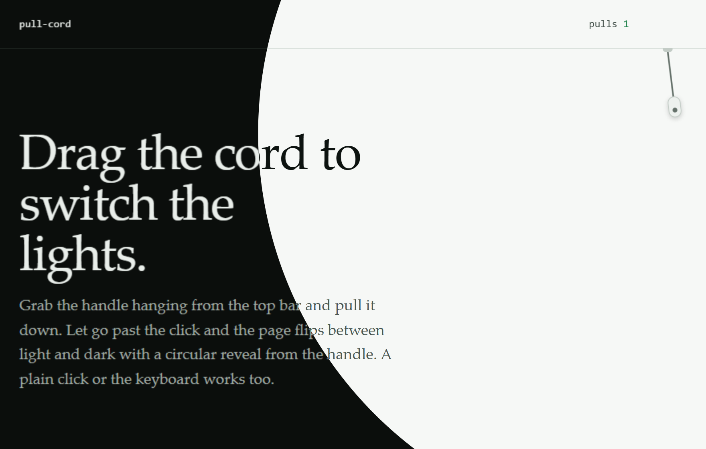

# web-components

Framework-agnostic web components. Each one lives in its own folder and is published as its own package.

| Component | Description |
| --- | --- |
| [`<dot-field>`](./dot-field) | Canvas dot grid that grows and lights up around the pointer, with an idle ripple |
| [`<github-activity>`](./github-activity) | GitHub contribution calendar with stats, themes and i18n, plus a build-time fetcher |
| [`<glass-nav>`](./glass-nav) | Floating frosted-glass navigation bar that highlights the section in view and scrolls to it with an offset |
| [`<pull-cord>`](./pull-cord) | Hanging light-switch cord you pull to toggle light and dark themes, with spring physics and a circular reveal |
| [`<scroll-ring>`](./scroll-ring) | Back-to-top button with a ring that fills as the page is read |
| [`<step-timeline>`](./step-timeline) | Process steps that fill in sequence when they come into view, or pin to the screen and advance with the scroll |

## License

MIT
