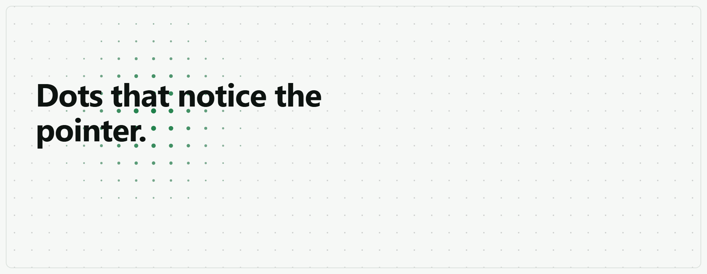

# `<dot-field>`

A dependency-free web component that draws a grid of dots on a canvas. Around the pointer the dots grow and light up, fading out smoothly with distance, and with no pointer around they ripple gently. Works in any stack: plain HTML, React, Vue, Svelte, Astro, Rails templates.

<picture>
  <source media="(prefers-color-scheme: dark)" srcset="https://raw.githubusercontent.com/georgepxto/web-components/main/dot-field/screenshots/dark.png">
  
</picture>

- No runtime dependencies, Shadow DOM, Canvas 2D (no WebGL), under 4 kB gzipped
- Sharp on high-density screens and resized automatically with `ResizeObserver`
- Stops drawing when it scrolls out of view or the tab is hidden
- Respects `prefers-reduced-motion`: the grid is drawn still and only redraws when the pointer moves
- Light and dark defaults, any color through CSS custom properties

<!-- TODO: add a GIF of the pointer moving across the field (screenshots/pointer.gif) -->

## Install

```sh
npm install @georgepxto/dot-field
```

```js
import '@georgepxto/dot-field';
```

Or load it from a CDN with no build step:

```html
<script type="module" src="https://cdn.jsdelivr.net/gh/georgepxto/web-components@main/dot-field/dist/index.js"></script>
```

## Usage

Give the field a size and put your content inside it. The canvas fills the element and the content sits on top:

```html
<dot-field style="min-height: 420px">
  <h1>Hello</h1>
</dot-field>
```

Or lay it behind existing content as a background. With `track="parent"` it keeps reacting while the pointer is over the content in front of it:

```html
<section class="hero">
  <dot-field track="parent"></dot-field>
  <h1>Hello</h1>
</section>

<style>
  .hero {
    position: relative;
  }

  .hero dot-field {
    position: absolute;
    inset: 0;
  }

  .hero h1 {
    position: relative;
  }
</style>
```

The canvas has `pointer-events: none`, so it never blocks clicks. The pointer is followed at the document level, which is why the field still reacts when other elements cover it.

## API

### Attributes

| Attribute | Default | Description |
| --- | --- | --- |
| `gap` | `24` | Distance between dots, in pixels |
| `radius` | `140` | Radius of the pointer's influence, in pixels |
| `dot-size` | `1` | Radius of a dot at rest, in pixels |
| `grow` | `3.5` | How many times larger a dot gets at the centre of the influence |
| `track` | `host` | `parent` reacts while the pointer is over the parent element instead of the field itself |
| `theme` | `auto` | `light`, `dark` or `auto` (follows `prefers-color-scheme`) |

## Theming

| Property | Default (light / dark) | Description |
| --- | --- | --- |
| `--dot-color` | `rgba(13, 19, 16, 0.18)` / `rgba(233, 238, 234, 0.16)` | Color of the dots at rest |
| `--dot-active-color` | `#1d8049` / `#43c97e` | Color near the pointer, drawn from 30% to 100% opacity as the pointer gets closer |

Any CSS color works, including `color-mix()` and custom properties from your page:

```css
dot-field {
  --dot-color: color-mix(in oklab, currentColor 14%, transparent);
  --dot-active-color: var(--accent);
}
```

If your site switches themes with an attribute, for example with [`<pull-cord>`](../pull-cord), set the colors per theme:

```css
:root[data-theme='light'] dot-field {
  --dot-color: rgba(13, 19, 16, 0.18);
}
```

The canvas is exposed as `::part(canvas)` and the content wrapper as `::part(content)`.

## Accessibility

The canvas is decorative and hidden from assistive technology with `aria-hidden`. Content placed inside the field stays in the normal reading order. With `prefers-reduced-motion: reduce` the idle ripple is off and nothing animates on its own; the dots near the pointer still change, without easing.

## Browser support

All current browsers. The component uses custom elements, Shadow DOM, Canvas 2D, `ResizeObserver` and `IntersectionObserver`.

## Development

```sh
npm install
npm test
```

`npm test` builds `dist/` and runs the unit tests. To try the demo, serve the package folder over HTTP and open `/demo/`.

## License

MIT
