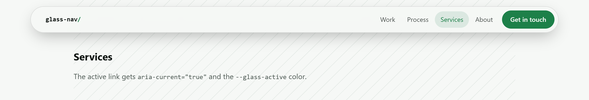
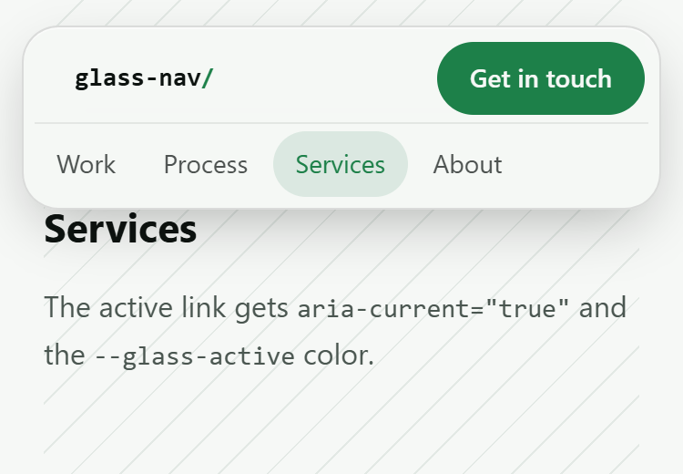

# `<glass-nav>`

A dependency-free web component for a floating, frosted-glass navigation bar. It highlights the link of the section in view and scrolls to a section without hiding its heading under the bar. Works in any stack: plain HTML, React, Vue, Svelte, Astro, Rails templates.

<picture>
  <source media="(prefers-color-scheme: dark)" srcset="https://raw.githubusercontent.com/georgepxto/web-components/main/glass-nav/screenshots/dark.png">
  
</picture>

- No runtime dependencies, Shadow DOM, about 4 kB gzipped
- Your own links and markup in three slots: logo, links and call to action
- Highlights the current section with `IntersectionObserver` and `aria-current`
- Smooth scrolling that stops below the bar, instant with `prefers-reduced-motion`
- Takes no space in the page flow
- In narrow screens the bar wraps into two rows instead of hiding the links behind a menu button



<!-- TODO: add a GIF of the active link following the scroll and a click scrolling to a section (screenshots/scroll.gif) -->

## Install

```sh
npm install @georgepxto/glass-nav
```

```js
import '@georgepxto/glass-nav';
```

Or load it from a CDN with no build step:

```html
<script type="module" src="https://cdn.jsdelivr.net/gh/georgepxto/web-components@main/glass-nav/dist/index.js"></script>
```

## Usage

Put the bar at the top of `<body>`. Links without a `slot` go in the middle and point to sections on the page by `id`:

```html
<glass-nav label="Main">
  <a slot="logo" href="#top">acme</a>
  <a href="#work">Work</a>
  <a href="#process">Process</a>
  <a href="#about">About</a>
  <a slot="cta" class="button" href="#contact">Get in touch</a>
</glass-nav>

<main id="top">
  <section id="work">…</section>
  <section id="process">…</section>
  <section id="about">…</section>
  <section id="contact">…</section>
</main>
```

The element is `position: sticky` with a height of zero, so the bar floats over the top of the page and stays there while it scrolls. Give the first block of your page enough top padding to clear it.

Links in the `logo` and `cta` slots scroll smoothly too, but only links in the default slot are highlighted.

## API

### Attributes

| Attribute | Default | Description |
| --- | --- | --- |
| `offset` | `88` | Distance in pixels kept between the top of the window and a section after scrolling to it. It is never smaller than the bar's own height plus 12px, so a wrapped bar doesn't cover the heading |
| `label` | | Accessible name of the `<nav>` landmark, for example `Main` |
| `theme` | `auto` | `light`, `dark` or `auto` (follows `prefers-color-scheme`) |
| `wrapped` | | Set by the component while the bar is split into two rows. Useful for styling |

### Properties

| Property | Description |
| --- | --- |
| `active` | `id` of the section currently highlighted, or `null` |
| `offset` | The `offset` attribute as a number |

### Events

| Event | Detail | Description |
| --- | --- | --- |
| `activechange` | `{ id }` | Fired when the highlighted section changes. `id` is `null` when no section is in view |

## Theming

| Property | Default (light / dark) | Description |
| --- | --- | --- |
| `--glass-bg` | `#f6f8f6` / `#0b0e0c` | Base color of the glass, used at 58% opacity |
| `--glass-fg` | `#0d1310` / `#e9eeea` | Text color. The border is mixed from it at 12% |
| `--glass-active` | `#1d8049` / `#43c97e` | Color of the active link and the focus ring |
| `--glass-highlight` | `rgba(255, 255, 255, 0.55)` / `rgba(255, 255, 255, 0.06)` | Inner highlight along the top edge |
| `--glass-max-width` | `1148px` | Widest the bar gets. It is never wider than the window minus 24px |
| `--glass-top` | `14px` | Distance from the top of the window |
| `--glass-wrapped-radius` | `20px` | Corner radius when the bar wraps into two rows |
| `--glass-z` | `50` | `z-index` of the bar |

```css
glass-nav {
  --glass-bg: #1e1b4b;
  --glass-fg: #eef2ff;
  --glass-active: #a5b4fc;
  --glass-max-width: 960px;
}
```

Style the internals with `::part()`: `nav`, `logo`, `links`, `cta`. Links in the default slot get a pill style; the logo and call to action are left to you. Styles from your page that target `a` directly win over the component's link styles, so scope them if needed, for example `glass-nav a { … }`.

## Accessibility

- The bar is a `<nav>` landmark; name it with `label`
- The active link has `aria-current="true"`
- After a click, focus moves to the section, so keyboard and screen reader users continue from there. Sections that can't take focus get `tabindex="-1"`
- The address bar is updated with the section's hash, so the back button works
- With `prefers-reduced-motion: reduce` the page jumps to the section instead of scrolling

## Browser support

All current browsers. The glass needs `backdrop-filter`; where it is missing, the bar falls back to a nearly opaque background.

## Development

```sh
npm install
npm test
```

`npm test` builds `dist/` and runs the unit tests. To try the demo, serve the package folder over HTTP and open `/demo/`.

## License

MIT
