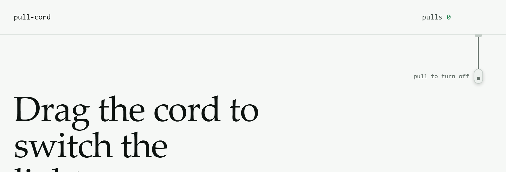
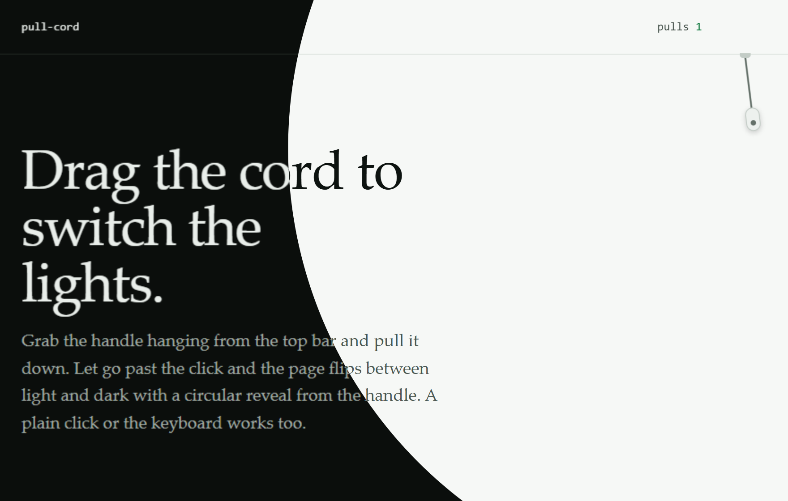

# `<pull-cord>`

A dependency-free web component that hangs a light-switch cord from your header. Drag the handle down past the click and the page switches between light and dark, revealed in a circle that grows from the handle. Works in any stack: plain HTML, React, Vue, Svelte, Astro, Rails templates.

<picture>
  <source media="(prefers-color-scheme: dark)" srcset="https://raw.githubusercontent.com/georgepxto/web-components/main/pull-cord/screenshots/dark.png">
  
</picture>

- No runtime dependencies, Shadow DOM, about 7 kB gzipped
- Spring physics: the cord sways at rest, swings when you brush past it, stretches as you pull and bounces back on release
- Circular theme reveal with the View Transitions API, skipped where unsupported or for visitors who prefer reduced motion
- Remembers the choice in `localStorage`, follows the system theme until the visitor picks one, and stays in sync across tabs and across several cords on the page
- Accessible: the handle is a real `switch` button, so a click, <kbd>Enter</kbd> or <kbd>Space</kbd> also toggles it
- A short click sound made with Web Audio, which you can turn off with `muted`
- English, Portuguese and Spanish built in, any other language through `labels`



## Install

```sh
npm install @georgepxto/pull-cord
```

```js
import '@georgepxto/pull-cord';
```

Or load it from a CDN with no build step:

```html
<script type="module" src="https://cdn.jsdelivr.net/gh/georgepxto/web-components@main/pull-cord/dist/index.js"></script>
```

## Usage

The component sets `data-theme="light"` or `data-theme="dark"` on `<html>`. Style your page from that attribute and hang the cord where you want it:

```html
<header class="site-header">
  <nav>…</nav>
  <pull-cord></pull-cord>
</header>

<style>
  :root {
    --bg: #0b0e0c;
    --text: #e9eeea;
    color-scheme: dark;
  }

  :root[data-theme='light'] {
    --bg: #f6f8f6;
    --text: #0d1310;
    color-scheme: light;
  }

  .site-header {
    position: relative;
  }

  .site-header pull-cord {
    position: absolute;
    top: 100%;
    right: 24px;
  }
</style>
```

The cord measures 44 × 120 px at rest. Only the handle takes pointer events, so the empty space around the cord never blocks clicks on your page.

### Avoid a flash of the wrong theme

The component only runs after your scripts load. Put this in `<head>` so the saved theme is applied before the first paint:

```html
<script>
  (() => {
    let theme = null;
    try {
      theme = localStorage.getItem('theme');
    } catch {}
    if (theme !== 'light' && theme !== 'dark') {
      theme = matchMedia('(prefers-color-scheme: light)').matches ? 'light' : 'dark';
    }
    document.documentElement.dataset.theme = theme;
  })();
</script>
```

Change `'theme'` and `dataset.theme` if you use a different `storage-key` or `attribute`.

### Tailwind and other class-based themes

```html
<pull-cord attribute="class"></pull-cord>
```

With `attribute="class"` the cord toggles the `dark` and `light` classes instead of an attribute, which is what Tailwind's `dark:` variant expects with `darkMode: 'class'`.

### Scope it to one element

```html
<section id="preview">
  <pull-cord target="#preview" storage-key="preview-theme" transition="none"></pull-cord>
</section>
```

## API

### Attributes

| Attribute | Default | Description |
| --- | --- | --- |
| `target` | `<html>` | CSS selector of the element that receives the theme |
| `attribute` | `data-theme` | Attribute set on the target, or `class` to toggle `light` and `dark` classes |
| `storage-key` | `theme` | `localStorage` key the choice is saved under |
| `no-persist` | | Don't save the choice |
| `transition` | `circle` | `none` switches instantly, without the circular reveal |
| `hint` | `auto` | `auto` shows the hint for 5 seconds and on hover or focus, `hover` only on hover or focus, `none` never |
| `hint-side` | `left` | `right` puts the hint on the right of the handle |
| `locale` | page language | Language of the hint and accessible label |
| `muted` | | Turns off the click sound |
| `theme` | | Reflects the current theme, `light` or `dark`. Set by the component, read it from CSS |

### Properties and methods

| Member | Description |
| --- | --- |
| `theme` | The current theme. Set it to `'light'` or `'dark'` to switch without animation; the choice is saved |
| `labels` | Overrides for the built-in text: `{ label, hintOn, hintOff }` |
| `toggle()` | Switches the theme with the same animation and sound as a pull |

### Events

| Event | Detail | Description |
| --- | --- | --- |
| `pull` | `{ theme, previous }` | Fired on every pull, before the theme changes. Call `preventDefault()` to keep the current theme |
| `themechange` | `{ theme, previous, source }` | Fired after the component changes the theme. `source` is `pull`, `property`, `system` or `storage` |

Both events bubble and cross shadow boundaries.

```js
const cord = document.querySelector('pull-cord');

cord.addEventListener('themechange', (event) => {
  const meta = document.querySelector('meta[name="theme-color"]');
  if (meta) meta.content = event.detail.theme === 'light' ? '#f6f8f6' : '#0b0e0c';
});
```

## Theming

Every color has a CSS custom property. Set them on `pull-cord`, or on `pull-cord[theme='light']` and `pull-cord[theme='dark']` for per-theme values.

| Property | Dark default | Light default |
| --- | --- | --- |
| `--pull-cord-length` | `56px` | `56px` |
| `--pull-cord-accent` | `#43c97e` | `#1d8049` |
| `--pull-cord-line` | `#7d8a82` | `#65716a` |
| `--pull-cord-mount` | `#2c352f` | `#c3ccc6` |
| `--pull-cord-pill` | `#101411` | `#edf1ee` |
| `--pull-cord-pill-border` | `#2c352f` | `#c3ccc6` |
| `--pull-cord-pill-hover` | `#7d8a82` | `#65716a` |
| `--pull-cord-dot` | accent, glowing | `#65716a` |
| `--pull-cord-hint` | `#7d8a82` | `#65716a` |
| `--pull-cord-hint-font` | `ui-monospace` stack | `ui-monospace` stack |

The accent colors the focus ring, and the dot while the lights are off. The cord's height grows with `--pull-cord-length`.

```css
pull-cord {
  --pull-cord-length: 84px;
  --pull-cord-line: #b08d57;
  --pull-cord-mount: #b08d57;
  --pull-cord-pill: #f3e3c3;
  --pull-cord-pill-border: #b08d57;
  --pull-cord-dot: #e0901e;
}
```

For anything else, style the parts: `line`, `mount`, `handle`, `pill`, `dot` and `hint`.

```css
pull-cord::part(hint) {
  font-family: 'Gochi Hand', cursive;
  font-size: 14px;
}
```

## Languages

The language comes from `locale`, then the nearest `lang` attribute, then the browser. English, Portuguese and Spanish are built in; for anything else, pass `labels`:

```js
document.querySelector('pull-cord').labels = {
  label: 'Mode clair',
  hintOn: 'tirez pour allumer',
  hintOff: 'tirez pour éteindre',
};
```

## Browser support

All current browsers. The circular reveal needs the View Transitions API (Chrome, Edge, Safari 18 and Firefox 144 or newer); elsewhere the theme switches instantly.

## Development

```sh
npm install
npm test
```

Then serve the folder over HTTP (for example `npx serve .`) and open `/demo/`.

## License

MIT
