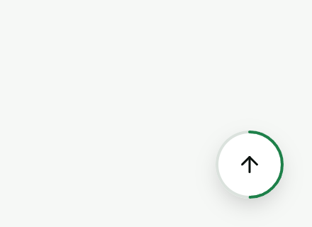

# `<scroll-ring>`

A dependency-free web component for a back-to-top button. A ring around the arrow fills as the page is read, and the button only appears once the reader has scrolled away from the top. Works in any stack: plain HTML, React, Vue, Svelte, Astro, Rails templates.

<picture>
  <source media="(prefers-color-scheme: dark)" srcset="https://raw.githubusercontent.com/georgepxto/web-components/main/scroll-ring/screenshots/dark.png">
  
</picture>

- No runtime dependencies, Shadow DOM, under 3 kB gzipped
- Reading progress from 0 to 100% drawn with an SVG ring
- Fades in after the reader scrolls past a set fraction of the window
- Returns focus to an element of your choice after scrolling up
- Passive scroll listener, updates batched with `requestAnimationFrame`
- Stays clear of the home indicator and rounded corners on phones with `env(safe-area-inset-*)`

<!-- TODO: add a GIF of the ring filling while scrolling and the button taking the page back up (screenshots/scroll.gif) -->

## Install

```sh
npm install @georgepxto/scroll-ring
```

```js
import '@georgepxto/scroll-ring';
```

Or load it from a CDN with no build step:

```html
<script type="module" src="https://cdn.jsdelivr.net/gh/georgepxto/web-components@main/scroll-ring/dist/index.js"></script>
```

## Usage

Add it once, anywhere in `<body>`. It positions itself in the bottom right corner:

```html
<h1 id="top">Article title</h1>
…
<scroll-ring focus-target="#top"></scroll-ring>
```

For the safe-area insets to apply on iPhone, the page needs `viewport-fit=cover`:

```html
<meta name="viewport" content="width=device-width, initial-scale=1, viewport-fit=cover" />
```

## API

### Attributes

| Attribute | Default | Description |
| --- | --- | --- |
| `show-after` | `0.6` | The button appears after scrolling this many window heights, and hides again above that |
| `focus-target` | | CSS selector of the element that receives focus after going back to the top, for example `#top` or `main` |
| `label` | `Voltar ao topo` | Accessible name and tooltip of the button |
| `theme` | `auto` | `light`, `dark` or `auto` (follows `prefers-color-scheme`) |
| `visible` | | Set by the component while the button is shown. Useful for styling |

### Properties

| Property | Description |
| --- | --- |
| `progress` | Reading progress of the page, from `0` to `1` |

## Theming

| Property | Default (light / dark) | Description |
| --- | --- | --- |
| `--ring-color` | `#1d8049` / `#43c97e` | Filled part of the ring and focus outline |
| `--ring-track` | `#dbe2dd` / `#1f2622` | Empty part of the ring |
| `--ring-bg` | `#ffffff` / `#101411` | Button background |
| `--ring-fg` | `#0d1310` / `#e9eeea` | Arrow color |
| `--ring-inset` | `20px` | Distance from the bottom and right edges, added to the safe-area insets |
| `--ring-z` | `40` | `z-index` of the button |

```css
scroll-ring {
  --ring-color: #f97316;
  --ring-track: #fed7aa;
  --ring-inset: 28px;
}
```

Style the internals with `::part()`: `button`, `ring`, `arrow`.

## Accessibility

- The button has an accessible name and a matching tooltip from `label`. The default is in Portuguese, so set `label` on pages in other languages, for example `label="Back to top"`
- While hidden, the button has `tabindex="-1"` and `aria-hidden="true"`, so it is skipped by the keyboard and screen readers
- After a click, focus moves to `focus-target`, so keyboard users don't have to tab through the page again. Elements that can't take focus get `tabindex="-1"`. Without a `focus-target`, the button gives up focus
- With `prefers-reduced-motion: reduce` the page jumps to the top and the button fades without sliding

## Browser support

All current browsers. The component uses custom elements, Shadow DOM, SVG and `env()`.

## Development

```sh
npm install
npm test
```

`npm test` builds `dist/` and runs the unit tests. To try the demo, serve the package folder over HTTP and open `/demo/`.

## License

MIT
