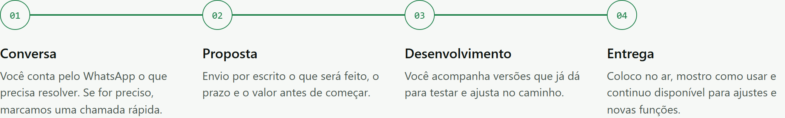
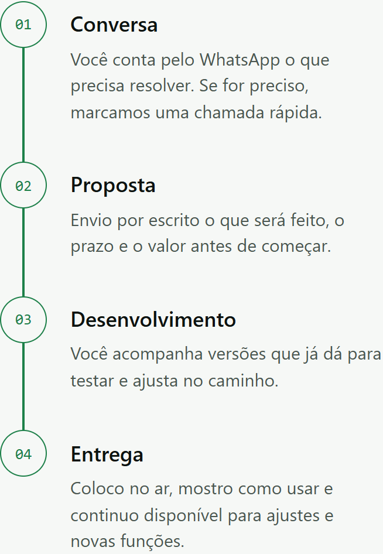
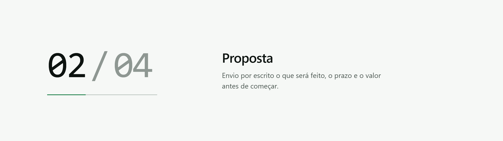

# `<step-timeline>`

A dependency-free web component for the steps of a process. By default the steps sit side by side on a line that fills in sequence when they come into view. In pinned mode the component holds the screen while the reader scrolls, showing one step at a time with a large counter. Works in any stack: plain HTML, React, Vue, Svelte, Astro, Rails templates.

<picture>
  <source media="(prefers-color-scheme: dark)" srcset="https://raw.githubusercontent.com/georgepxto/web-components/main/step-timeline/screenshots/reveal-dark.png">
  
</picture>

- No runtime dependencies, Shadow DOM, under 5 kB gzipped
- Steps written as plain HTML with `<step-item>`, so the content is in the page even before the script loads
- Two modes: a timeline that fills in when it scrolls into view, and a pinned, scroll-driven presentation
- Stacks vertically in narrow containers, and pinned mode turns into a plain list on small screens and for reduced motion
- Accessible: a real list, a live region for the active step and a full list of steps for screen readers in pinned mode

<!-- TODO: add a GIF of the line filling in and of the pinned mode advancing while scrolling (screenshots/reveal.gif, screenshots/pinned.gif) -->

## Install

```sh
npm install @georgepxto/step-timeline
```

```js
import '@georgepxto/step-timeline';
```

Or load it from a CDN with no build step:

```html
<script type="module" src="https://cdn.jsdelivr.net/gh/georgepxto/web-components@main/step-timeline/dist/index.js"></script>
```

The package registers both `<step-timeline>` and `<step-item>`.

## Usage

Each step is a `<step-item>` with its title in `title` and its text as content. The content can hold any inline HTML, like links or emphasis:

```html
<step-timeline>
  <step-item title="Conversa">Você conta pelo WhatsApp o que precisa resolver.</step-item>
  <step-item title="Proposta">Envio por escrito o que será feito, o prazo e o valor.</step-item>
  <step-item title="Desenvolvimento">Você acompanha versões que já dá para testar.</step-item>
  <step-item title="Entrega">Coloco no ar e mostro como usar.</step-item>
</step-timeline>
```

The component reads the steps and renders its own copy, and it re-renders when you add, remove or edit them.

### Reveal mode

The default. The numbered circles sit on a horizontal line that fills in green, one segment after the other, the first time at least 35% of the timeline is in view. Below 640px of container width the steps stack and the line runs down the left side.



### Pinned mode

```html
<step-timeline mode="pinned" step-height="80vh">
  …
</step-timeline>
```

The component becomes `steps × step-height` tall and its inner stage sticks to the top of the window while the page scrolls through it. On the left, a large counter (`02 / 04`) and a progress bar; on the right, the title and text of the active step, crossfading as it changes. The active step is the share of the scroll inside the component: with four steps, the first quarter shows step 1, the second quarter step 2, and so on.

<picture>
  <source media="(prefers-color-scheme: dark)" srcset="https://raw.githubusercontent.com/georgepxto/web-components/main/step-timeline/screenshots/pinned-dark.png">
  
</picture>

Below 768px of window width, or with `prefers-reduced-motion: reduce`, pinned mode falls back to a plain vertical list that doesn't hold the screen. The `layout` attribute tells you which one is showing.

If a fixed header covers the top of the window, push the stage below it with `--step-sticky-top`.

## API

### Attributes

| Attribute | Default | Description |
| --- | --- | --- |
| `mode` | `reveal` | `reveal` or `pinned` |
| `step-height` | `70vh` | Scroll length of each step in pinned mode. Accepts `px`, `vh`, `svh`, `lvh`, `dvh`, `rem` and `em` |
| `theme` | `auto` | `light`, `dark` or `auto` (follows `prefers-color-scheme`) |
| `layout` | | Set by the component: `reveal`, `pinned` or `list` (pinned mode's fallback) |

`<step-item>` takes a `title` attribute and any content.

### Properties

| Property | Description |
| --- | --- |
| `layout` | The layout currently shown: `reveal`, `pinned` or `list` |
| `index` | Index of the active step in pinned mode, `-1` otherwise |

### Events

| Event | Detail | Description |
| --- | --- | --- |
| `stepchange` | `{ index, title }` | Fired in pinned mode when the active step changes |

## Theming

| Property | Default (light / dark) | Description |
| --- | --- | --- |
| `--step-accent` | `#1d8049` / `#43c97e` | Filled line, active circles and progress bar |
| `--step-text` | `#0d1310` / `#e9eeea` | Titles and counter |
| `--step-muted` | `#4a5650` / `#a3ada6` | Step text, pending numbers and counter total |
| `--step-border` | `#c3ccc6` / `#2c352f` | Empty line, pending circles and progress track |
| `--step-bg` | `#f6f8f6` / `#0b0e0c` | Inside of the circles. Match your page background |
| `--step-font` | `inherit` | Font of titles and text |
| `--step-mono-font` | `ui-monospace` stack | Font of the numbers and counter |
| `--step-gap` | `32px` | Space between steps |
| `--step-circle-size` | `40px` | Diameter of the numbered circles |
| `--step-stagger` | `0.45s` | Time between one step lighting up and the next |
| `--step-title-size` | `18px` | Step titles |
| `--step-text-size` | `15px` | Step text |
| `--step-counter-size` | `clamp(3rem, 8vw, 6rem)` | Counter in pinned mode |
| `--step-active-title-size` | `clamp(1.5rem, 2.6vw, 2.25rem)` | Active title in pinned mode |
| `--step-active-text-size` | `18px` | Active text in pinned mode |
| `--step-sticky-top` | `0px` | Offset of the pinned stage from the top of the window |

```css
step-timeline {
  --step-accent: #7c3aed;
  --step-circle-size: 48px;
  --step-font: 'Inter', sans-serif;
}
```

Style the internals with `::part()`: `steps`, `step`, `number`, `title`, `text`, and in pinned mode `pinned`, `stage`, `meter`, `counter`, `bar`, `active`.

## Accessibility

- The steps are an ordered list. The circles' numbers are hidden from screen readers, which announce the list position instead
- In pinned mode the active step is in an `aria-live="polite"` region, so the change is announced, and a visually hidden list with every step is always available. The counter and bar are decorative and hidden
- Pinned mode doesn't hold the screen on small screens or for visitors who prefer reduced motion. In reveal mode, reduced motion shows the line already filled

## Browser support

All current browsers. The component uses custom elements, Shadow DOM, container queries, `position: sticky` and the `svh` unit.

## Development

```sh
npm install
npm test
```

`npm test` builds `dist/` and runs the unit tests. To try the demo, serve the package folder over HTTP and open `/demo/`.

## License

MIT
